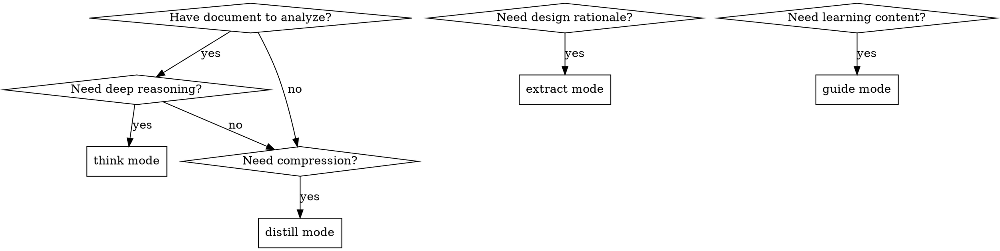

# Analyze Document

## Overview
Four document analysis modes: think (speculative reasoning), distill (compression), extract (design rationale), guide (pedagogical transformation).

## When to Use

## Quick Reference

| Mode | Purpose | Output |
|------|---------|--------|
| **think** | Speculative reasoning, causal analysis | Simplified Chinese, principle-first deep reasoning |
| **distill** | Compression, signal amplification | Structure-first compression with clarity |
| **extract** | Design philosophy, architecture | Principle-first design tenets |
| **guide** | Pedagogical learning content | Simplified Chinese, 2025-compatible progression |

## Implementation

### think - Deconstructive Analysis

- Identify fundamental concepts and architectural patterns
- Generate self-consistent analysis revealing causal interconnections
- Verify reasoning through edge case exploration
- Output: Simplified Chinese, Markdown, principle-first deep reasoning

### distill - Content Compression

- Eliminate redundancy, amplify signal
- Maintain logical flow, reduce verbosity strategically
- Output: Structure-first compression with enhanced clarity

### extract - Design Rationale

- Engineering tradeoffs, architectural patterns, design decisions
- Causal analysis of WHY decisions were made (not just WHAT)
- Output: Principle-first reasoning documenting core design tenets

### guide - Learning Transformation

- Progression from first principles to practical application
- Concrete examples demonstrating architectural decisions
- Output: Simplified Chinese, 2026-compatible learning progression

## Common Mistakes

| Mistake | Fix |
|---------|-----|
| Wrong output language | think/guide require Simplified Chinese |
| Missing causal reasoning | extract focuses on WHY not WHAT |
| Losing structure in distill | Maintain logical flow while compressing |
| Skipping first principles in guide | Start from fundamentals, not implementation |
